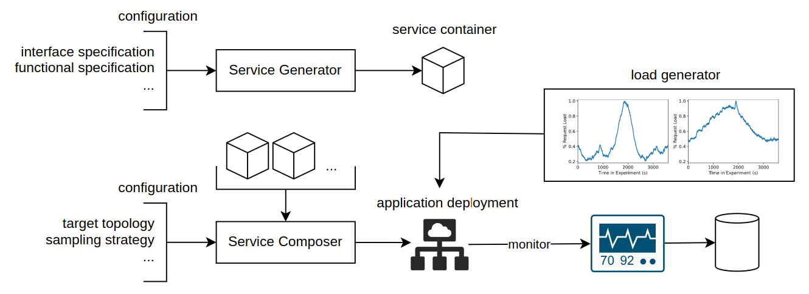

# dsg-testbed

A testbed for measuring the performance of containerized services, alone and composed into pipelines, under
controlled load. It records what happened to every single request, so that the data can be used to learn and
verify performance models of services and of their compositions.



The testbed has five parts, following the figure:

| Part | What it does |
|---|---|
| **Service generator** | Turns a service description into a checked service container. A service can be written by hand or generated by an AI assistant from a short interview. Every service passes the same verification before it is used. |
| **Service composer** | Turns an experiment file, which names the services, how they are connected and which settings to explore, into a deployment: one container per service with its CPU and memory limits, all on one private network. |
| **Load generator** | Drives the first services of a pipeline at an absolute rate in requests per second or at a target utilization of the busiest service, constant or following a load trace that changes every second, with arrivals from evenly spaced to more irregular than Poisson. |
| **Application deployment and monitor** | Starts the containers, sets their configuration, runs the load, watches queues and containers, and stops everything in order. Prometheus and Grafana can show a run live. |
| **Storage** | Every run leaves a results folder with one row per request, one row per second, a summary per service, and the exact deployment file that was used. |

Inside every service container runs the same runtime. It receives requests, holds them in a queue, releases
them in time windows, processes them with a pool of worker processes, and records five timestamps per request.
The service author writes only the processing function. Everything that is measured is measured by the runtime,
so the numbers mean the same for every service.

What can be varied in an experiment, per service: the CPU cores (fixed, or set by the testbed from what the
workers use), the memory, the number of worker processes, the window settings, and the service's own knobs such
as input quality or model choice. For the whole pipeline: the topology (chains, branches, trees whose merges wait
for every branch), the load, and how services are chained.

## Contents

1. [Setup](#1-setup)
2. [See what services exist](#2-see-what-services-exist)
3. [Measure one service](#3-measure-one-service)
4. [Explore a configuration space](#4-explore-a-configuration-space)
5. [Run a pipeline of services](#5-run-a-pipeline-of-services)
6. [Use a load pattern instead of a constant rate](#6-use-a-load-pattern-instead-of-a-constant-rate)
7. [Generate a new service with an assistant](#7-generate-a-new-service-with-an-assistant)
8. [Write a service by hand](#8-write-a-service-by-hand)
9. [Verify a service](#9-verify-a-service)
10. [Watch a run live](#10-watch-a-run-live)
11. [Collect the data](#11-collect-the-data)
12. [Test the testbed](#12-test-the-testbed)
13. [After changing the runtime code](#13-after-changing-the-runtime-code)
14. [Reference](#14-reference)

## 1. Setup

### On a new machine

The machine needs Linux, Docker with Compose v2, cgroup v2, Python 3.10 or newer, and internet access during
setup. Everything else is done by one script.

**Step 1.** Clone the repository and run the script:

```bash
git clone <repository> dsg-testbed
cd dsg-testbed
./setup.sh
```

The script checks the machine and stops with a plain message if something is missing. Then it installs the
`just` command runner into `~/.local/bin`, creates the Python environment in `.venv`, writes `node.yaml` for
this machine, fetches, builds and checks every service, and runs the unit tests. It prints one line per step.
It takes about twenty minutes the first time, most of it downloading models and data (about one gigabyte) and
building images. It can be run again at any time; steps that are done are skipped in seconds.

Two options: `./setup.sh --no-services` prepares only the code, and `./setup.sh --with-integration-test` ends
with the tests that start real containers, which take a few more minutes.

**Step 2.** In every new shell, before working:

```bash
cd dsg-testbed
source .venv/bin/activate
export PATH="$HOME/.local/bin:$PATH"
just                                    # lists every command
```

**Step 3.** Check that everything is in place:

```bash
just services                           # every service should be verified
just run experiments/qr-detector-single.yaml
```

### What the script does, as separate commands

Each step is also a command of its own, for when only one of them is needed:

| Command | What it does |
|---|---|
| `just setup-node` | writes `node.yaml`: which CPUs services may use, which are kept for the testbed, and the local ports. It keeps the first two physical cores with their SMT siblings for the testbed and gives the rest to services. An existing `node.yaml` is kept; `dsg setup-node --overwrite` writes it again |
| `just setup` | for every service in `services/`: runs its `prepare.sh` if it has one, builds its image if it is not built, and runs the service's own tests inside the image. `dsg setup --rebuild` builds every image again, for example after a change to the runtime |
| `just test` | the unit tests |

`node.yaml` can be edited by hand afterwards, for example to give services fewer CPUs on a shared machine:

```yaml
workload_cpuset: 2-15,18-31        # CPUs services may use
infrastructure_cpuset: 0-1,16-17   # CPUs kept for the testbed and the monitor
control_port: 18080                # local ports; one per service in a pipeline, counting up
metrics_port: 18000
prometheus_port: 19090
cadvisor_port: 18090
grafana_port: 13000
```

Copying the repository to another machine copies the code and the small sample data. The large files under
`services/*/*/fetched/` and the models are fetched again by `just setup`, or they can be copied over by hand,
in which case `just setup` sees them and skips the download. Measurements from different machines are not
comparable; every run records the hardware it ran on in `provenance.json`.

## 2. See what services exist

```bash
just services
```

Prints each service, its version, and its status: `verified`, `failed`, or `not verified`. Only verified
services should be used in experiments. Running an experiment with an unverified service prints a warning.

The services that come with the repository:

The services that come with the repository, 31 versions of 29 services. For video frames and LiDAR scans
`data_quality` is the frame height in pixels or the distance in metres around the car; for audio it is the
seconds of audio.

| Service | What it does | Knobs |
|---|---|---|
| **Vision** | | |
| `qr-detector v1` | decodes the QR code in each video frame | `data_quality` 100–1000 |
| `cv-analyzer v1` | detects objects in each video frame with YOLOv10 and draws them | `data_quality` 128–320; `model_size` 1–4 (nano, small, medium, large) |
| `cv-analyzer v2` | the same detector, returns boxes, classes and scores | `data_quality` 160–640; `model_size` 1–4 |
| `face-detector v1` | detects faces in each video frame | `model_size` 1–2 (320 or 640 pixel input) |
| `face-detector v2` | detects faces at the frame height the knob asks for | `data_quality` 160–640; `model_size` 1–2 |
| `edge-detector v1` | finds edges and returns the contours they form | `data_quality` 160–640; `smoothing` 3–15 |
| `image-compressor v1` | encodes each frame into a compressed image | `data_quality` 100–1000; `encoding_quality` 10–95; `format` jpeg/webp/png |
| `image-denoiser v1` | removes noise while keeping edges | `data_quality` 160–640; `strength` 1–5 |
| `image-transformer v1` | resizes, corrects colours or geometry | `data_quality` 160–640; `correction` resize/colour/geometric |
| `motion-detector v1` | returns the regions that moved since the last frame | `data_quality` 160–640; `method` difference/optical_flow |
| `frame-source v1` | the camera of a tree: stamps each frame with a checksum before it goes to every detector | `checksum` crc32/adler32 |
| **LiDAR** | | |
| `pc-visualizer v1` | renders a scan as a bird's-eye view | `data_quality` 6–60 |
| `pc-downsampler v1` | keeps one point per voxel | `data_quality` 6–60; `voxel_size` 0.05–1.0 |
| `pc-clusterer v1` | clusters the points into objects, one box each | `data_quality` 6–60; `voxel_size` 0.05–1.0; `cluster_distance` 0.3–2.0 |
| `pc-encoder v1` | quantises and packs a scan | `data_quality` 6–60; `precision` 1–4 |
| `pc-registrar v1` | aligns a scan with the one before it | `data_quality` 6–60; `iterations` 5–40 |
| `ground-remover v1` | removes the ground plane | `data_quality` 6–60; `attempts` 20–400 |
| `normal-estimator v1` | estimates one surface normal per point | `data_quality` 6–60; `neighbours` 5–40 |
| **Audio** | | |
| `speech-transcriber v1` | transcribes speech | `model_size` 1–2; `data_quality` 2–12 |
| `audio-resampler v1` | resamples, removes the offset, normalises loudness | `data_quality` 2–12; `target_rate` 8000/22050/44100 |
| `audio-denoiser v1` | suppresses background noise | `data_quality` 2–12; `resolution` 512/1024/2048 |
| `audio-features v1` | mel spectrogram and MFCC features | `data_quality` 1–12; `mel_bands` 20–256; `frame_ms` 10–100 |
| `audio-encoder v1` | encodes each clip into a compressed file | `data_quality` 2–12; `format` flac/ogg |
| `voice-detector v1` | finds the stretches in which somebody speaks | `data_quality` 2–12; `frame_length` 10–30 |
| `pitch-tracker v1` | one pitch value per frame | `data_quality` 2–12; `hop_length` 5–40 |
| **Data and IoT** | | |
| `text-indexer v1` | compresses a text and builds a term index | `data_quality` 10–100; `compression_level` 1–9; `ngram_size` 1–3 |
| `log-parser v1` | matches log lines against templates and counts events | `data_quality` 100–2000; `pattern_count` 5–200 |
| `table-joiner v1` | joins orders with customers and aggregates per group | `data_quality` 1000–1000000; `group_count` 10–100000 |
| `hash-signer v1` | hashes and key-stretches each payload | `data_quality` 1–1024; `algorithm` sha256/sha512/blake2b/sha3_256; `rounds` 1000–200000 |
| `sensor-aggregator v1` | summarises a window of multichannel readings | `window_length` 64–8192; `channels` 1–64; `feature_set` basic/spectral/full |
| `anomaly-detector v1` | finds anomalous points in a sensor window | `window_length` 256–16384; `model_size` 1–3; `threshold` 2.0–6.0 |

Many of them need files that are too large for git: models, LiDAR scans, audio clips, texts. Each such service
has a `prepare.sh` that fetches them from a fixed source and checks them. `just setup` does this for all
services at once; `just prepare <service> <version>` does it for one.

## 3. Measure one service

**Step 1.** Write an experiment file in `experiments/`, or use one of the `*-single.yaml` files that exist for
every service, for example `experiments/qr-detector-single.yaml`:

```yaml
nodes:
  qr:
    service: qr-detector v1
    cores: 2                     # CPU quota of the container
    parallelism: 1               # worker processes
    knobs:
      data_quality: 552          # a knob declared in the service's spec.yaml
load:
  rps: 40                        # requests per second
run:
  warmup_seconds: 5              # requests arriving in this time are recorded as phase "warmup"
  measure_seconds: 20            # requests arriving in this time are recorded as phase "measure"
```

Settings that are left out take a default: the knob defaults of the service, one worker, one core more than
workers, 8 GB of memory.

**Step 2.** Run it:

```bash
just run experiments/qr-detector-single.yaml
```

The testbed checks the file, starts the container, sets the knobs, starts the workers and warms them up, runs the
load, records every request, stops the load, lets the service finish every request it accepted, collects the
files, and removes the container. About 40 seconds.

**Step 3.** Read the last lines it prints. They name the results folder and say whether the run was valid:

```
[qr-detector-single] 1/1 run-0000 rps=40.0 -> valid | qr: 832 items, 7.6 ms
[qr-detector-single] dataset -> results/qr-detector-single/<time>/dataset.csv
```

**Step 4.** Look at the data:

```bash
cd results/qr-detector-single/<time>/
cat dataset.csv                          # one row: settings, load, latency statistics, valid
head runs/run-0000/qr/records.csv        # one row per request
cat runs/run-0000/qr/run_summary.json    # counts, achieved rate, flags
```

## 4. Explore a configuration space

**Step 1.** In the experiment file, turn any value into a list. Each list is one dimension; single values stay
fixed. For example `experiments/qr-detector-explore.yaml`:

```yaml
nodes:
  qr:
    service: qr-detector v1
    cores: [2, 3, 5]
    parallelism: [1, 2, 4]
    knobs:
      data_quality: [300, 552, 800]
load:
  rps: [20, 50, 100]
run:
  warmup_seconds: 10
  measure_seconds: 60
  repetitions: 2
  runs: 30                       # 30 random combinations out of the 81; leave out to run all of them
  seed: 0                        # the same 30 every time
```

**Step 2.** Estimate the time:

```bash
just estimate experiments/qr-detector-explore.yaml     # runs, nodes, largest core sum, expected hours
```

The estimate counts the load of each run plus 15 seconds plus 3 seconds per service. Slow services and long
drains take longer; treat it as a lower bound. The runs are executed in random order.

**Step 3.** Start it inside `tmux`, so it continues after logging out:

```bash
tmux new -s explore
just run experiments/qr-detector-explore.yaml
```

Detach with `Ctrl-b d`, return with `tmux attach -t explore`.

**Step 4.** `dataset.csv` is rewritten after every run. It can be read while the exploration runs, and nothing
is lost if the exploration stops early.

**Step 5.** To run many experiment files one after another, run them as a campaign:

```bash
just campaign my-campaign experiments/benchmark/*.yaml
```

`results/campaigns/my-campaign/status.txt` gets a line when each file starts and finishes, with the valid and
invalid runs so far; `log.txt` has every run. A run that crashes is recorded as invalid and the experiment goes
on.

**Large spaces.** A range is written `{from: 160, to: 640, step: 32}`. With `runs: N` the testbed keeps N random
points of the space, also when the space is too large to list. `repetitions: R` with `repeated_share: S` repeats
only a share S of the runs. `shared_knobs:` at the top of the file draws one value per run and gives it to every
service that has that knob, so a whole pipeline runs at one quality:

```yaml
shared_knobs:
  data_quality: {from: 160, to: 640, step: 32}
```

Only one experiment can run at a time on a machine, because experiments share the same local ports and CPUs.

## 5. Run a pipeline of services

**Step 1.** Add more nodes and the edges between them:

```yaml
nodes:
  qr:   {service: qr-detector v1, cores: 2, knobs: {data_quality: 552}}
  face: {service: face-detector v1, cores: 2, knobs: {model_size: 1}}
edges:
  - qr -> face                   # qr comes first, face after it
load:
  rps: 30                        # goes to the first service only
run:
  warmup_seconds: 5
  measure_seconds: 30
```

**Step 2.** Choose how the services are chained, with one line for the whole pipeline. Leave it out for the
default.

```yaml
link: rates        # default: once per window, the finished count of a service becomes the rate of the next one
link: requests     # every finished request is handed to the next service and followed end to end
```

| | `link: rates` | `link: requests` |
|---|---|---|
| What the next service gets | a number per second | each request, at the moment it is finished |
| Numbers per service | yes | yes, the same ones |
| Time of one request from start to finish | no | yes |
| End-to-end mean and percentiles | no | yes, measured |
| Counts along the chain | agree within a few per cent | agree exactly |

In both cases no data travels between services. Each service processes its own sample data; what travels is a
rate, or the identity of a request. A **request** enters the pipeline and travels through it under one
`request_id`. An **item** is one service's piece of work on a request.

**Step 3.** For a graph with branches, add more edges:

```yaml
edges:
  - a -> b                       # a feeds b and c: each gets everything a finishes
  - a -> c
  - b -> d                       # d receives from b and from c
  - c -> d
```

A service that feeds several others sends everything to each of them. A service fed by several others receives
the sum. Cycles are refused. A service may appear more than once under different node names.

For trees in which a merge must wait for all of its branches (map-reduce, a camera fanned out to several
detectors whose results are combined), add one line:

```yaml
link: requests
fan_in: join       # a service with several feeders waits until every feeder handed over the same request
```

With `fan_in: join` the request is queued once, after its last input arrived; `trace_steps.csv` then has
`waiting_for_inputs_ms`, the time between the first and the last input. The default `fan_in: each` queues every
handover on its own. `experiments/b3/` has balanced, narrow and star trees built this way, with `frame-source v1`
as the camera.

**Step 4.** Run it like any other experiment. The services are started last first, so that nobody hands a
request to a service that is not ready, and stopped first first, each one draining before the next is stopped.

**Step 5.** Read the results. `dataset.csv` has one row per service, and every row carries the settings of all
services in the pipeline as `<node>.<setting>` columns, because how a service behaves depends on what is before
it. With `link: requests` there are two more files in each run folder:

```
runs/run-0000/traces.csv          one row per request: entered, left, total time, completed
runs/run-0000/trace_steps.csv     one row per request and service: handover, waiting, processing
```

and `dataset.csv` has `requests_entered`, `requests_completed`, and `end_to_end_mean_ms`, `end_to_end_p50_ms`,
`end_to_end_p95_ms`, `end_to_end_p99_ms`. For every request the handover, waiting and processing times of all its
steps add up exactly to its total time.

## 6. Use a load pattern instead of a constant rate

**Step 1.** See which patterns exist:

```bash
just patterns                    # constant, bursty, diurnal
```

`bursty` and `diurnal` are one-hour traces with one value per second, taken from the elastic-workbench project.

**Step 2.** In the experiment file, name the pattern and give the peak rate. The rate then follows the trace,
updated every second:

```yaml
load:
  rps: 80                        # the peak of the trace
  pattern: bursty
  pattern_start_second: 0        # where in the hour the run starts
  arrival_process: poisson       # how requests are spaced within a second: poisson or deterministic
```

**Step 3.** Run it. The rate each service actually received, second by second, is in its `metrics.csv`. Every
rate change is also listed in its `run_summary.json`.

### Load as a utilization

A rate in requests per second means something different for every configuration. To load every configuration
equally, give a utilization instead:

```yaml
load:
  utilization: [0.1, 0.4, 0.6, 0.8, 1.0]   # the busy share of the busiest service
  arrival_process: renewal
  arrival_variability: 1                   # squared coefficient of variation of the gaps
run:
  probe_seconds: 8
  measure_requests: 400                    # measure until about 400 requests entered ...
  measure_seconds: 30                      # ... but at least 30 s
  longest_measure_seconds: 180             # ... and at most 180 s
```

Each run first sends a few requests for `probe_seconds`, reads every service's processing time, and sets the rate
to utilization ÷ (sources feeding the service × processing time ÷ min(workers, cores)) of the busiest service.
`arrival_variability` 0 spaces requests evenly, 1 is Poisson, above 1 is more irregular. `dataset.csv` has
`utilization_asked` and `utilization_measured`.

### Cores set by the testbed

With `cpu_slack` under `run:`, the probe also measures how many cores a busy worker uses, and sets each service's
cores to `cpu_slack` × workers × that, in steps of 0.05. The `cores` in the file are then the cores during the
probe and the upper limit.

| Setting | Where | Effect |
|---|---|---|
| `cpu_slack: 1.15` | `run:` | cores = 1.15 × workers × cores per busy worker |
| `cap_cores_at_the_probe: true` | `run:` | a service that needs more than its probe cores gets its probe cores and is listed in `cores_capped`, instead of an invalid run; `throttled_fraction` shows what that cost |
| `auto_cores: false` | node | this node keeps its `cores` (for example a camera whose own work is tiny) |
| `cores_beyond_the_workers: 0.5` | node, instead of `cores` | the node gets its drawn `parallelism` plus 0.5 cores in every run |
| `cores_may_exceed_the_machine: true` | `run:` | the core limits of a run may add up to more than the workload CPUs; limits are caps, not reservations |

## 7. Generate a new service with an assistant

A service can be written by an AI assistant such as Claude Code or Codex, following a written procedure. The
person decides what the service does; the assistant decides how it is built; the testbed judges the result.

**Step 1.** Make sure the repository has no uncommitted changes under `src/` or `tests/`. Verification refuses a
new service if anything outside its own folder was changed.

```bash
git status
```

**Step 2.** Open the assistant in the repository and say:

> Let's generate a new service. Follow `procedures/GENERATE_SERVICE.md`.

**Step 3.** Answer four questions: what the service should do, which data it works on, what can be tuned, and
any limits such as memory or packages that must not be used. Confirm the brief it shows.

**Step 4.** Do nothing else. The assistant writes the service folder, builds the image, runs the service's own
tests and `just verify` until it passes, and reports what it built and how the service behaves. Services need
not involve machine learning; plain processing such as compressing, filtering, parsing or converting is just as
welcome.

**Step 5.** Check the result and keep it:

```bash
just services                                        # the new service shows as verified
cat services/<name>/v1/verification_report.json
git add services/<name> experiments/<name>-single.yaml
git commit -m "Add <name> v1"
```

The procedure for generating many services at once is described in
`procedures/GENERATE_BATCH.md`.

### Generate a whole application

An application is several services connected into a pipeline or a graph. Open the assistant in the repository
and say:

> Let's generate an application. Follow `procedures/GENERATE_APPLICATION.md`.

It asks five questions about the application: what it does, its stages and what flows between them, which
stages already exist, how the stages are chained, and the time budget. It shows the briefs of the new stages
once for a yes, then generates and verifies them one by one, writes the experiment file, does a short smoke
run, runs the exploration, and reports. Nothing else may run on the machine meanwhile.

## 8. Write a service by hand

**Step 1.** Make a skeleton:

```bash
just new-service my-service                          # writes services/my-service/v1/
```

The folder holds `brief.yaml`, `spec.yaml`, `service.py`, `test_service.py`, `requirements.txt` and `data/`. The
skeleton already builds and verifies as it is.

**Step 2.** Edit `spec.yaml` to declare the knobs with their ranges, and `service.py` for the two functions:

```python
def init_worker(cfg):              # runs once per worker process: load samples and models, return them
    return state

def process(item, cfg, state):     # runs once per request; this is the only code whose time is measured
    return output
```

`cfg.<knob>` holds the knob values, `cfg.service_directory` the folder inside the image, `item.sample_index`
which sample to process. Put sample data in `data/`, Python packages in `requirements.txt`, system packages in
`apt.txt`. Files too large for git are fetched by a `prepare.sh` into `fetched/`, which git ignores. The full
contract, including the rules of no own threads, no network, no timing, is in
`procedures/SERVICE_CONTRACT.md`.

**Step 3.** Write a test named `test_proof` in `test_service.py` that checks the service does its job on the
real samples, in a way that a service which does nothing would fail.

**Step 4.** Build, check, verify:

```bash
just prepare my-service v1       # only if there is a prepare.sh
just build my-service v1
just check my-service v1         # the service's own tests, inside the image
just verify my-service v1        # the testbed's judgement, about three minutes
```

**Step 5.** Fix what `verify` reports, repeat step 4, then commit the folder. A version folder that was verified
is never edited again; a change is a new folder `v2` next to it.

## 9. Verify a service

Verification is the testbed's own judgement of a service. It runs only when someone types the command: after a
service is new, after its image was rebuilt, or to get a fresh description of how it behaves.

```bash
just verify qr-detector v1
```

It fails a service when: a required file is missing, the brief or the spec cannot be read, the spec's knobs are
not the ones the brief asks for, there is no test named `test_proof`, files outside the service folder were
changed, the image does not build, the service's own tests fail, or a short real run on a closed network does not
complete every request. The closed network proves that the service makes no network calls.

It then records, without failing: how long one request takes at default settings, the memory of one worker, the
effect of every knob at its lowest and highest value, and whether the service uses more CPU than its workers
explain. The full report is `services/<name>/<version>/verification_report.json`, and it keeps the outcome of
every earlier run. On success it also writes `experiments/<name>-single.yaml` with a fitting arrival rate, if
that file does not exist.

## 10. Watch a run live

**Step 1.** From your own machine, open a tunnel to the server:

```bash
ssh -L 13000:127.0.0.1:13000 -L 19090:127.0.0.1:19090 <server>
```

**Step 2.** On the server, start the monitoring stack:

```bash
just monitor-up
just monitor-status              # does Prometheus see the running services?
```

**Step 3.** Start any experiment. Open `http://localhost:19090` for Prometheus or `http://localhost:13000` for
Grafana (user `admin`, password `adminadmin`). The ports are the ones in `node.yaml`. Every service exposes `throughput`, `avg_p_latency`, `cores`,
`rps`, its knobs, `queue_length`, `workers_busy` and the item counters.

**Step 4.** Afterwards:

```bash
just monitor-down
```

Runs do not depend on the monitor. It is only for watching.

## 11. Collect the data

**Step 1.** All results are under `results/<experiment>/<time>/`. They are not in git.

```
results/<experiment>/<time>/
  experiment.yaml          the file that was used
  provenance.json          git commit, dirty flag, hardware
  dataset.csv              one row per run and service
  summary.json             the experiment in one file: workflow, hardware, outcome, per service, per run
  runs/run-0000/
    run.json               the plan, validity, problems, and per service: image id, CPU throttling, memory
    compose.yaml           exactly what was deployed
    <node>/records.csv         one row per request
    <node>/metrics.csv         one row per window
    <node>/run_summary.json    counts, achieved rate, rate changes received, worker thread settings, flags
    traces.csv               only with link: requests
    trace_steps.csv          only with link: requests
```

**Step 2.** Read `summary.json` first. It describes the workflow (services, edges, link, load, the explored
space), the hardware and image ids, the outcome (valid and invalid runs and their flags), each service's
processing and waiting time as min, median and max plus marginal means per knob, the end-to-end numbers for
`link: requests`, and every run with its settings and numbers. It is written at the end of `just run`;
`just summarize <folder>` writes it again for an existing results folder, and for a campaign folder writes one
that lists every experiment of the campaign.

**Step 3.** Copy a folder to your own machine:

```bash
rsync -a <server>:dsg-testbed/results/qr-detector-explore ./data/
```

**Step 4.** Stack several experiments into one table. They share their columns:

```python
import glob
import pandas as pd

dataset = pd.concat(pd.read_csv(file) for file in glob.glob("data/*/*/dataset.csv"))
```

**Step 5.** Keep only valid rows for modelling: `dataset[dataset.valid]`. The `flags` column says why a row is
not valid.

| Flag | Meaning |
|---|---|
| `<node>:saturated_queue` | the queue of that service reached its cap; the load was stopped, every accepted request was still finished and recorded |
| `<node>:saturated_link` | too many finished requests were waiting to be handed to the next service |
| `<node>:handover_failed` | a finished request could not be handed to the next service |
| `<node>:next_hop_unreachable` | a service could not tell the next service its rate |
| `<node>:overloaded` | the service still held more than two seconds of backlog when the measurement ended; it could not keep up with the load |
| `<node>:offered_load_late` | the load generator could not keep the requested rate |
| `<node>:drain_timeout` | the service gave up finishing its accepted requests after the drain time |
| `drain_not_finished:<node>` | requests were still unfinished when the run gave up waiting |
| `container_exited:<node>`, `killed_for_memory:<node>` | the container of that service died |
| `probe_not_finished` | the probe requests of a utilization load were not finished in time |
| `cores_needed_above_the_probe_cores:<node>` | with `cpu_slack`, the service needs more cores than it had during the probe (see `cap_cores_at_the_probe`) |
| `cores_set_above_the_workload_cpus` | with `cpu_slack`, the cores set for all services add up to more than the workload CPUs |

A run that crashes leaves no row; the output says `INVALID (crashed: ...)` and the experiment goes on.

Rows of runs that were flagged keep their records. They show which configurations cannot sustain a load; they
should not be used for latency.

Two limits of the testbed itself to keep in mind. The runtime hands requests to the workers one at a time, so a
service faster than about one millisecond per request tops out at roughly 1000 requests per second whatever its
number of workers; for such a service the ceiling is the testbed, not the service. And with the default
one-second windows, most of a request's time is waiting for the next window tick in every service it passes;
use `discipline: fifo` to measure the services without that.

## 12. Test the testbed

```bash
just test                        # unit tests, no Docker, no network, about 10 seconds
just test-integration            # real containers: one service, a chain, a chain of three with requests,
                                 # and verification of a fresh skeleton; a few minutes
```

## 13. After changing the runtime code

The runtime is part of every service image. After a change under `src/dsg/service_runtime/`,
`src/dsg/load_generator/` or `src/dsg/monitor/`, rebuild every image:

```bash
dsg setup --rebuild
```

## 14. Reference

### Every command

| Functionality | Command |
|---|---|
| Prepare a new machine | `./setup.sh` |
| Write `node.yaml` for this machine | `just setup-node` |
| Fetch, build and check every service | `just setup` |
| List services with their status | `just services` |
| Run an experiment: one service, an exploration, a pipeline | `just run experiments/<file>.yaml` |
| Expected runs, cores and hours of experiment files, without running them | `just estimate <files>` |
| Run several experiments one after another | `just campaign <name> experiments/<folder>/*.yaml` |
| Write `summary.json` for a results or campaign folder | `just summarize <folder>` |
| List the load patterns | `just patterns` |
| New service with an assistant | open Claude Code or Codex, point it at `procedures/GENERATE_SERVICE.md` |
| New service by hand | `just new-service <name>`, then `build`, `check`, `verify` |
| Fetch what a service needs, such as models or data | `just prepare <service> <version>` |
| Build a service image | `just build <service> <version>` |
| Run a service's own tests inside its image | `just check <service> <version>` |
| The testbed's judgement of a service | `just verify <service> <version>` |
| Watch live | `just monitor-up`, `just monitor-status`, `just monitor-down` |
| Test the testbed | `just test`, `just test-integration` |

### The experiment file

| Where | What can be set |
|---|---|
| under a node | `service` as `name version`; `cores` or `cores_beyond_the_workers`; `memory`; `parallelism`; `rps` (own rate of a source); `auto_cores`; the window settings `window_ms`, `batch_size`, `discipline` (`window` or `fifo`) |
| under a node's `knobs:` | whatever the service's `spec.yaml` declares |
| `edges:` | `a -> b` lines |
| `link:` | `rates` (default) or `requests` |
| `fan_in:` | `each` (default) or `join` (needs `link: requests`) |
| `shared_knobs:` | knobs drawn once per run and given to every service that has them |
| under `load:` | `rps` or `utilization`; `pattern`; `pattern_start_second`; `trace_speed`; `burst_factor`; `burst_seconds`; `arrival_process` (`poisson`, `deterministic`, `renewal`); `arrival_variability` |
| under `run:` | `warmup_seconds`; `measure_seconds`; `measure_requests`; `longest_measure_seconds`; `probe_seconds`; `queue_capacity`; `repetitions`; `repeated_share`; `runs`; `seed`; `cpu_slack`; `cap_cores_at_the_probe`; `cores_may_exceed_the_machine` |

Every value can be a list or a range `{from: a, to: b, step: s}`; each one is a dimension of the space.

Before anything starts the file is checked. An unknown service, an edge to a missing node, a cycle, a knob the
service does not have, a value outside its range, a setting in the wrong place, or more cores than the machine
offers are refused with a plain message.

### The columns of `records.csv`

| Column | Meaning |
|---|---|
| `item_id` | identity of the item inside this service |
| `request_id`, `request_entered_at_ns`, `handed_over_by` | the request this item belongs to, when it entered the pipeline, and which service handed it over (empty in the first service) |
| `config_id` | hash of all knob values of this run |
| `admission_phase` | `warmup` or `measure`, decided when the request entered the pipeline |
| `scheduled_at_ns` | when the arrival schedule planned the request |
| `arrived_at_ns` | when it entered this service's queue |
| `released_at_ns`, `window_index` | the window that released it for processing |
| `started_at_ns` | taken inside the worker right before `process()` |
| `finished_at_ns` | taken inside the worker right after `process()` |
| `worker_id` | process id of the worker |
| `outcome` | `completed` or `failed` |
| `queue_length_at_arrival`, `workers_busy_at_arrival` | state seen by the arriving request |

All `_ns` values are nanoseconds on one monotonic clock; only differences are meaningful. Processing time is
`finished - started`, waiting time is `started - arrived`, time in the service is `finished - arrived`.

### How a service behaves

1. Requests arrive at the requested rate, independent of how fast the service is, and wait in a queue.
2. Every `window_ms` (default 1000) a tick releases up to `batch_size` waiting requests. Earlier released ones
   keep priority.
3. Free workers take released requests in order. There are `parallelism` workers.
4. Requests not finished when the next tick comes simply continue. Nothing is cancelled, nothing is dropped.
5. While a run is processing, knobs cannot change. Every record belongs to exactly one configuration.

With `discipline: fifo`, step 2 disappears: a request can start as soon as a worker is free.

### Control API of a running service

Every service listens on port 8080 inside its container, mapped to a local port on the host, one per service
starting at the `control_port` in `node.yaml`.

```
PUT /quality_scaling?data_quality=552
PUT /parallelism_scaling?parallelism=2
PUT /model_scaling?model_size=3
PUT /knob?name=window_ms&value=1000        any other knob
PUT /change_rps?client_id=C_1&rps=40       set the arrival rate; rates of different clients add up
PUT /handover?request_id=...               hand over a finished request (used between services)
PUT /start_processing                      locks the knobs, starts and warms the workers
PUT /start_measurement                     requests arriving from now on are phase "measure"
PUT /stop_processing                       stops arrivals, finishes every accepted request, writes the files
GET /status        GET /knobs
```

Out-of-range values are refused with `400`, a knob change while processing with `409`. Prometheus metrics are on
port 8000.

### Where things are

| Path | Content |
|---|---|
| `src/dsg/` | the testbed, one package per component; each has a `README.md` |
| `services/<name>/<version>/` | the service store |
| `experiments/` | one YAML file per experiment: `*-single.yaml` one per service; `preliminary/` first single-service sweeps; `weekend/` and `deep/` load patterns, chains to depth 50, trees to 40 nodes; `applications/` vision, audio and LiDAR chains (B1) and their utilization and variability sweeps (B4); `benchmark/` every service alone at five utilizations; `b3/` trees with joins. Folders with a `write_experiments.py` are written by it |
| `briefs/` | batch briefs written while following `procedures/GENERATE_BATCH.md` |
| `results/` | run output, not in git |
| `tests/unit/`, `tests/integration/` | tests without Docker; tests with real containers |
| `procedures/` | what an assistant or a person follows to generate a service, a batch of services, or an application |
| `node.yaml` | CPUs and ports of this machine, written by `just setup-node`; not in git |
| `setup.sh` | prepares a new machine |
| `ARCHITECTURE.md` | how the code is organised |
